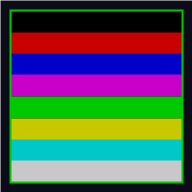

# RetroSystem

Emulador de **ZX Spectrum 48K** y (próximamente) **MSX1** para escritorio (Windows, Linux, macOS) y **Android**, escrito en **C# / .NET 10** con **MonoGame**.



---

## Estado actual: Spectrum v1.1

Esta versión entrega un emulador **totalmente funcional** del ZX Spectrum 48K con:

- **CPU Z80** emulada con timing de 3,5 MHz, contención de memoria ULA y raster exacto.
- **ULA de vídeo**: pantalla 256×192 con atributos (ink / paper / bright / flash), borde dinámico que muestra las clásicas barras de carga horizontales.
- **Audio del beeper** (escritorio) con modelo analógico Chris-Smith (mezcla EAR/MIC + filtro RC).
- **Carga de cintas** en formatos `.TAP` y `.TZX` (con Fast Load opcional interceptando la rutina LD-BYTES en `0x0556`).
- **Teclado completo** mapeado a la matriz de 8×5 teclas del Spectrum.
- **Controles táctiles** en Android: D-pad (QAOP), botones A/B, y **teclado QWERTY en pantalla** con modificadores SHIFT/SYM.
- **Selector de cintas integrado** (Storage Access Framework) — sin necesidad de ADB.
- **Menú en pantalla** con accesos rápidos a: Cargar cinta, Teclear LOAD, Fast Load toggle, Reset, Ayuda.
- **Barra de estado** en tiempo real con el nombre de la cinta y el estado del emulador.
- **ROM 48K incluida** (c) Sinclair Research Ltd / Amstrad plc, distribuida con permiso.

---

## Estructura del repositorio

```
retrosystem/
├── Z80/                  # CPU Z80 (núcleo reutilizable)
├── Tape/                 # Biblioteca TZX/TAP/TSX
├── common/               # Abstracciones (IAssetProvider, ILogger)
├── spectrum.core/        # Spectrum emulador (multi-target: net10.0 + net10.0-android)
├── spectrum/             # Launcher de escritorio (CLI)
├── spectrum.android/     # Aplicación Android con UI táctil
│   ├── fetch_rom.ps1     # Script que descarga 48.rom desde rustzx
│   └── Assets/spectrum/  # Aquí se coloca 48.rom (16 KB) antes de compilar
├── docs/                 # (próximamente) notas de diseño
└── releases/             # APKs compilados listos para distribuir
```

---

## Cómo ejecutar (escritorio)

### 1. Preparar la ROM

```powershell
# Si tienes 48.rom de otro origen, cópialo a spectrum/ junto al ejecutable
Copy-Item path\to\48.rom C:\Dev\retrosystem\spectrum\48.rom
```

### 2. Compilar y ejecutar

```powershell
# Desde la raíz del repositorio
dotnet build spectrum/spectrum.csproj
dotnet run --project spectrum/spectrum.csproj
```

### 3. Cargar una cinta

```powershell
dotnet run --project spectrum/spectrum.csproj -- -t spectrum\mi_juego.tzx
```

Añade `-f` para usar la **carga rápida** (sin esperar los tiempos de audio de la cinta):

```powershell
dotnet run --project spectrum/spectrum.csproj -- -t spectrum\mi_juego.tzx -f
```

### 4. Controles de escritorio

| Tecla | Acción |
|-------|--------|
| Teclado del PC | Matriz completa del Spectrum (mapeada fila a fila) |
| **F1** | Play / Pause de la cinta |
| **F2** | Rebobinar la cinta al inicio |
| **Esc** | Salir del emulador |

---

## Cómo ejecutar (Android)

### Opción A: instalar el APK precompilado

Visita la página de [Releases](../../releases) y descarga `spectrum-v*.apk`.

```powershell
adb install -r spectrum-v1.1.0.apk
```

El APK ya incluye la ROM 48K, así que arranca directamente con la pantalla `© 1982 Sinclair Research Ltd`. Solo necesitas cargar una cinta.

### Opción B: compilar desde código fuente

```powershell
# 1) Descargar ROM 48K automáticamente
pwsh spectrum.android/fetch_rom.ps1

# 2) Compilar APK (debug)
dotnet build spectrum.android/spectrum.android.csproj

# 3) Compilar APK optimizado (release)
dotnet build spectrum.android/spectrum.android.csproj -c Release -f net10.0-android
```

El APK firmado se genera en:
```
spectrum.android/bin/Release/net10.0-android/net.retrosystem.spectrum-Signed.apk
```

### Cómo cargar un juego en Android

1. **Pulsa el botón "📂 LOAD"** en la barra superior derecha.
2. Se abre el selector de archivos del sistema.
3. Elige cualquier `.tap` o `.tzx` de tu dispositivo.
4. Activa **Fast Load** desde el menú `☰` (carga instantánea sin esperar audio).
5. Pulsa **"⌨️ Teclear LOAD" + Enter** en el menú para que el Spectrum ejecute `LOAD ""` automáticamente.
6. La pantalla mostrará `Loading...` y el juego cargará.

### Controles táctiles

| Botón en pantalla | Tecla del Spectrum | Uso típico |
|-------------------|--------------------|------------|
| **D-pad ▲▼◄►** | Q / A / O / P | Movimiento (joystick QAOP) |
| **A** (verde) | SPACE | Acción principal (disparar / saltar) |
| **B** (rojo) | M | Acción secundaria |
| **📂 LOAD** (arriba dcha.) | (file picker) | Abre el selector de cintas del sistema |
| **☰** (arriba dcha.) | (menú) | Menú con Type LOAD, Reset, Fast Load, Help |
| **KBD** (panel dcho.) | (toggle) | Muestra/oculta el teclado QWERTY |
| **TAPE** (panel dcho.) | (toggle) | Play/pause de la cinta |
| **Teclado QWERTY** | Teclas equivalentes | Permite escribir `LOAD ""` y demás comandos BASIC |
| **SHIFT** en teclado | CAPS SHIFT | Mayúsculas / símbolos |
| **SYM** en teclado | SYMBOL SHIFT | Símbolo Shift (puntuación) |

---

## Descargar APK precompilado

Visita la página de [Releases](../../releases) y descarga el último `spectrum-v*.apk`.

> Los APKs publicados están firmados con la clave de depuración de .NET (válidos para instalar en cualquier dispositivo con "Orígenes desconocidos" habilitado, **no son aptos para Google Play**).
>
> La **ROM 48K ya viene incluida** en el APK, descargada en tiempo de build desde [rustzx/rustzx](https://github.com/rustzx/rustzx) (MIT) que tiene permiso explícito de Amstrad para distribuirla junto con emuladores.

---

## Requisitos

- **.NET SDK 10.0** (descarga desde [dotnet.microsoft.com](https://dotnet.microsoft.com/download))
- Para Android: **SDK de Android** (se instala automáticamente con el workload `net10.0-android` de .NET)
- Drivers ADB si quieres instalar vía USB (incluidos en *Android Platform Tools*)

```powershell
# Verificar SDK
dotnet --list-sdks
```

---

## Comandos útiles

```powershell
# Compilar todo (escritorio + Android)
dotnet build retrosystem.slnx

# Solo el Spectrum escritorio
dotnet build spectrum/spectrum.csproj

# Solo el APK de Android (debug)
dotnet build spectrum.android/spectrum.android.csproj

# APK de Android (release, optimizado con AOT)
dotnet build spectrum.android/spectrum.android.csproj -c Release -f net10.0-android

# Instalar / lanzar
adb install -r spectrum.android/bin/Debug/net10.0-android/net.retrosystem.spectrum-Signed.apk
adb shell am start -n net.retrosystem.spectrum/crc6431ebdb18024b6c91.Activity1

# Ver logs de la app
adb logcat -s Spectrum SpectrumDBG "*:S"

# Re-descargar la ROM (si necesitas resetearla)
pwsh spectrum.android/fetch_rom.ps1
```

---

## Próximos pasos (roadmap)

- [ ] **MSX1** (v2): portar el emulador MSX existente de z80emu a la misma arquitectura multi-target.
- [ ] **Audio del beeper en Android** (v2): el actual usa `DynamicSoundEffectInstance` de MonoGame; en Android requiere afinación de buffers.
- [ ] **Gestor de cintas integrado** (v2): navegador de archivos local para no abrir el picker cada vez.
- [ ] **Guardar / cargar snapshots** (v2): estado completo (Z80 + ULA + RAM 48K) en `.z80`/`.sna`.
- [ ] **Joystick físico** (v3): soporte para gamepads Bluetooth en Android (mapeo automático a QAOP).
- [ ] **128K** (v3): modelo de Spectrum 128K con paginación de memoria y chip AY.

---

## Créditos y licencias

Este proyecto no habría sido posible sin el trabajo de la comunidad open source. Agradecimientos a:

### Proyectos base
- **[z80emu](C:\Dev\z80emu)** — Proyecto personal del mismo autor. El núcleo Z80, la biblioteca Tape y las abstracciones comunes proceden de ahí.
- **[MonoGame](http://monogame.net)** — Framework gráfico y de audio (MS-PL). Copyright © 2004–2024 MonoGame Team.

### Hardware emulado
- **Sinclair Research Ltd (1982)** — Arquitectura del ZX Spectrum 48K.
- **Chris Smith** — *"The ZX Spectrum ULA: How to Design a Microcomputer"*, referencia técnica de la ULA.

### ROM
- **Amstrad plc** — Copyright (C) 1982 Sinclair Research Ltd. Amstrad ha dado [permiso explícito](https://groups.google.com/forum/?hl=en#!msg/comp.sys.amstrad.8bit/HtpBU2Bzv_U/HhNDSU3MksAJ) para distribuir la ROM junto con emuladores. Se incluye en este proyecto con permiso.
- **[rustzx/rustzx](https://github.com/rustzx/rustzx)** (MIT) — Fuente de la ROM 48K descargada en build time.
- **[fuse-emulator/fuse](https://github.com/fuse-emulator/fuse)** (GPL) — Fuente alternativa de la ROM.

### Interfaces y patrones UI (inspiración)
- **[Swordfish90/Lemuroid](https://github.com/Swordfish90/Lemuroid)** (GPL-3.0) — Inspiración principal para la pantalla de librería (`TapeLibraryActivity`), el patrón de recientes con SharedPreferences, el escaneo automático de archivos, y la estética general (paleta oscura, cards redondeadas, badges TAP/TZX, sección "Recientes" + "Todas las cintas"). El código ha sido reescrito desde cero en C# / Android Views; el diseño visual está inspirado en este proyecto.
- **[deanthecoder/ZXSpeculator](https://github.com/deanthecoder/ZXSpeculator)** (MIT) — Patrones de mapeo de teclado, Type LOAD, y la idea de integrar una búsqueda de cintas desde el menú.
- **[rustzx/rustzx](https://github.com/rustzx/rustzx)** (MIT) — Incluye la ROM con permiso de Amstrad, lo que nos permite empaquetarla en el APK.

### Cómo citar / dar crédito
Si haces un fork de este proyecto, por favor mantén esta sección de créditos y enlaza a los proyectos OSS de los que deriva.

### Licencia de este proyecto

### Licencia de este proyecto

```
MIT License

Copyright (c) 2026 davidpoar

Permission is hereby granted, free of charge, to any person obtaining a copy
of this software and associated documentation files (the "Software"), to deal
in the Software without restriction, including without limitation the rights
to use, copy, modify, merge, publish, distribute, sublicense, and/or sell
copies of the Software, and to permit persons to whom the Software is
furnished to do so, subject to the following conditions:

The above copyright notice and this permission notice shall be included in all
copies or substantial portions of the Software.

THE SOFTWARE IS PROVIDED "AS IS", WITHOUT WARRANTY OF ANY KIND, EXPRESS OR
IMPLIED, INCLUDING BUT NOT LIMITED TO THE WARRANTIES OF MERCHANTABILITY,
FITNESS FOR A PARTICULAR PURPOSE AND NONINFRINGEMENT. IN NO EVENT SHALL THE
AUTHORS OR COPYRIGHT HOLDERS BE LIABLE FOR ANY CLAIM, DAMAGES OR OTHER
LIABILITY, WHETHER IN AN ACTION OF CONTRACT, TORT OR OTHERWISE, ARISING FROM,
OUT OF OR IN CONNECTION WITH THE SOFTWARE OR THE USE OR OTHER DEALINGS IN THE
SOFTWARE.
```
